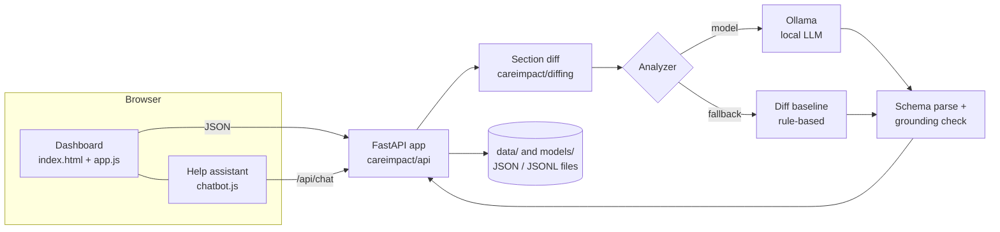

# CareImpact AI — Project Documentation

**Healthcare policy. Translated into action.**

This document explains the whole CareImpact AI project: the problem it solves, how it works end to end, how
the code is organised, how to run and deploy it, and what its limits are. For the short command reference,
see [README.md](README.md).

---

## Contents

1. [The problem](#1-the-problem)
2. [What CareImpact AI does](#2-what-careimpact-ai-does)
3. [Using the website](#3-using-the-website)
4. [How it works (architecture)](#4-how-it-works-architecture)
5. [Data: real and synthetic](#5-data-real-and-synthetic)
6. [The AI model: training and inference](#6-the-ai-model-training-and-inference)
7. [Evaluation and benchmarks](#7-evaluation-and-benchmarks)
8. [The help assistant (chatbot)](#8-the-help-assistant-chatbot)
9. [Code structure](#9-code-structure)
10. [API reference](#10-api-reference)
11. [Setup, running and deployment](#11-setup-running-and-deployment)
12. [Configuration](#12-configuration)
13. [Testing](#13-testing)
14. [Safety, privacy and responsible use](#14-safety-privacy-and-responsible-use)
15. [Known limitations and future work](#15-known-limitations-and-future-work)
16. [Glossary](#16-glossary)

---

## 1. The problem

Medicare coverage in the United States is defined in part by **Local Coverage Determinations (LCDs)**:
long policy documents published by Medicare Administrative Contractors in the CMS **Medicare Coverage
Database (MCD)**. LCDs are revised often. A revision might:

- add or remove a covered indication,
- change a clinical threshold (for example a test score or a number of treatment sessions),
- add documentation that providers must keep,
- change diagnosis codes or billing instructions,
- or only fix typos and formatting.

Hospitals, billing teams and clinics have to know which revisions actually affect them. Reading two long
versions side by side by hand is slow and error-prone, and the "what changed" notes in the policy are often
incomplete.

## 2. What CareImpact AI does

CareImpact AI takes **two versions of the same policy** and produces:

1. **A section-by-section diff** of what was added, removed or modified (deterministic, no AI).
2. **An analysis** of each change, written by a small language model (or a rule-based baseline):
   - a category (coverage, clinical criteria, documentation, coding & billing, provider requirements,
     retirement/replacement, administrative, no substantive change, or insufficient evidence),
   - a plain-language description of the change,
   - **exact quotes** from the old and new text as evidence,
   - the possible operational impact and a recommended action,
   - a qualitative confidence label.
3. **A grounding check**: every quote is matched against the source text. Quotes that cannot be found are
   flagged as unsupported so a person can check them.

The key design idea: **the diff is the source of truth, the model only explains it, and every claim is
checked.** The model is never trusted on its own.

## 3. Using the website

Start the app (see [section 11](#11-setup-running-and-deployment)) and open http://127.0.0.1:8000.

| Page | What it is for |
|---|---|
| **Home** | Welcome screen. *Try a sample comparison* runs a demo in one click. Shows dataset counts and the latest benchmark results. |
| **Compare Policies** | The main tool. Choose the old version (step 1) and new version (step 2) from a saved document, an official CMS link, or pasted text. Pick an analyzer (step 3) and press *Compare Policies*. *Load a sample pair*, *Swap* and *Clear* buttons help you get started. |
| **Policy Library** | All version pairs available locally: fictional synthetic samples and real CMS pairs. Press *Compare* on a row to open it. |
| **Dataset & Training** | Measured counts of the training data, scenario and class balance, and training runs. |
| **Model Benchmarking** | Scores of each analyzer on held-out evaluation sets, plus example failures. |
| **Help & Responsible Use** | What the app does, its limits, and an FAQ. |

The **status chips** in the top bar show which model is active, whether the local AI server (Ollama) is
reachable, and the dataset size. The **Ask CareImpact** button (bottom right, every page) opens the help
assistant.

### Reading a comparison result

- **Warnings** (yellow) appear first, for example when a version is synthetic, unverified, or when the app
  fell back to the baseline.
- **Change summary** and **summary cards** give the overall classification and finding counts.
- **Findings** list each change with old/new quotes. A green **✓ found in source** badge means the quote was
  matched; a red **⚠ not found in source** badge means it was not and needs checking.
- **Side-by-side diff** shows every section: `−` removed, `+` added, `~` modified. Unchanged runs collapse.

## 4. How it works (architecture)



**Request flow for a comparison** (`POST /api/compare`):

1. Each side is loaded: a saved document from `data/`, a page fetched from the official MCD (and validated),
   or pasted text split into sections by its headings.
2. `diffing` normalises section headings, pairs sections between versions, splits text into sentences and
   computes a sentence-level diff with a similarity score per section.
3. A prompt is built from the changed sections only (`analysis/prompts.py`) — the same builder is used for
   training and inference, so the model sees the same format in both.
4. The analyzer runs:
   - **Ollama model**: decoding is constrained to the `PolicyAnalysis` JSON schema.
   - **Diff baseline**: rules over the diff, no AI.
   If the model is unreachable or returns invalid JSON, the service falls back to the baseline **and says so**.
5. `analysis/validation.py` parses the output and checks every quote against the source text
   (whitespace-normalised exact match) and that each finding refers to a section that actually changed.
6. Warnings are added (synthetic data, unverified sources, unsupported quotes, mismatched document IDs) and the
   result is returned to the UI.

**Storage.** There is no database. Everything is plain JSON/JSONL files under `data/` and `models/`, which
keeps the project easy to inspect, version and reproduce.

## 5. Data: real and synthetic

### Real CMS data (`careimpact/ingestion`)

- The **CMS Coverage API** lists final LCDs.
- For each LCD, version-specific MCD pages (`lcd.aspx?lcdid=…&ver=…`) are downloaded with a **polite HTTP
  client**: rate-limited (1.5 s between requests), retried, and cached on disk so reruns are incremental.
- Each page is parsed into a `PolicyDocument` (ID, version, title, dates, contractor, sections) and
  **validated**: a version is `verified` only if the page's embedded document ID, version, LCD ID field and
  title match the request **and** real policy content was extracted. HTTP 200 alone is not success.
- Pairs of consecutive versions are written to `data/interim/pairs.jsonl` as `verified`, `unverified` or
  `unavailable` (old version could not be retrieved). Nothing is ever fabricated to fill a gap.
- `draft-real` drafts an analysis for verified, non-identical pairs. A person then approves or rejects each
  draft with `review`. Drafts with unsupported quotes cannot be approved. **Only approved real examples are used
  for training or evaluation.**

### Synthetic data (`careimpact/synthetic`)

Real labelled data is scarce, so the project generates fictional training examples:

- **12 fictional policy families** (`topics.py`) with realistic structure, `SYN-` IDs, "(Synthetic)" titles and
  a fictional contractor.
- **20 change scenarios** (`generator.py`), such as new or removed coverage indications, expanded or narrowed
  eligibility, threshold changes, added/removed documentation, diagnosis code and billing changes, provider
  qualifications, supervision, new limitations, effective-date revisions, retirement/replacement,
  administrative edits, no substantive change and deliberately ambiguous evidence.
- The **label comes from the scenario specification, not from an AI**, so it is correct by construction.
- Every example passes consistency checks (quotes exist, sections really changed, classes match) and
  deduplication. Failures go to `data/training/review/` and never reach training.
- Test examples use **held-out policy families**, so evaluation measures generalisation to unseen policies.

### Dataset building (`careimpact/dataset`)

`build-dataset` combines approved real examples and validated synthetic examples into chat-format
`train.jsonl` / `val.jsonl` with a manifest. It caps per-policy contributions, splits by policy, and **fails
loudly** if any held-out family or policy ID leaks into training.

## 6. The AI model: training and inference

- **Base model**: Qwen2.5 Instruct (0.5B / 1.5B / 3B). Small models were chosen so the app runs on a laptop
  CPU through **Ollama**.
- **Fine-tuning**: LoRA supervised fine-tuning (`careimpact/training/train_lora.py`) with configs in
  `configs/training/`:
  - `cpu_smoke.yaml` — 0.5B, 8 steps on CPU. A feasibility test; measured results are in
    `models/runs/cpu_smoke_0p5b/summary.json`.
  - `colab_t4_1p5b.yaml`, `colab_t4_3b_qlora.yaml` — real runs on a free Colab/Kaggle T4 GPU.
- **Export**: `careimpact/training/export.py` merges the adapter, saves it in float16, converts it to GGUF
  with llama.cpp's converter (`--llama-cpp <checkout>`) and writes an Ollama `Modelfile`, so the model can be
  registered with `ollama create careimpact-ft -f Modelfile`. GGUF is required because current Ollama versions
  cannot import Qwen2 safetensors directly.
- **Colab workflow**: `colab/finetune_colab.ipynb` does training + export on a free T4 GPU and saves the result to
  Google Drive; `colab/import_finetuned.ps1` imports it into Ollama and benchmarks it. To rebuild the upload
  bundle after changing code or data:
  ```powershell
  python -c "import zipfile,pathlib as P; z=zipfile.ZipFile('colab/careimpact_bundle.zip','w',zipfile.ZIP_DEFLATED); [z.write(p,p.as_posix()) for d in ('careimpact','configs','data/training/final') for p in P.Path(d).rglob('*') if p.is_file() and '__pycache__' not in p.parts]; z.write('requirements-train.txt')"
  ```
- **Why not train on the laptop?** The CPU test run measured 192 s per optimizer step for the 0.5B model, so a
  full 2-epoch run would take about a day (0.5B) or several days (1.5B). A T4 GPU does it in 1–2 hours.
- **Inference**: `careimpact/inference/service.py` sends the prompt to Ollama with structured-output decoding
  and falls back to the baseline on any failure.

Licensing note: Qwen2.5 0.5B/1.5B/7B are Apache-2.0; **3B uses the Qwen Research License (non-commercial)**.

## 7. Evaluation and benchmarks

`python -m careimpact.cli evaluate --model <name>` scores an analyzer on a held-out set and writes results to
`data/evaluation/results/` and `data/reports/benchmark_report.md`.

| Metric | Meaning |
|---|---|
| Classification accuracy | Overall change class is correct |
| Substantive change F1 | Correctly separates substantive from non-substantive changes |
| Finding recall / missed important changes | How many expected changes were found |
| Finding category accuracy | Category of each matched finding |
| Unsupported claim rate | Findings whose quotes are not in the source (lower is better) |
| Evidence exact-match | Share of quotes found verbatim in the source |
| Valid JSON (schema) | Output parsed into the required schema |
| Section coverage | Changed sections that were mentioned |
| No-change handling / abstention | Correctly says "no change" or abstains on ambiguous input |
| Latency, model memory | Practical cost on this hardware |

**Synthetic and real results are always reported separately.** Synthetic scores are not evidence of real-world
accuracy.

## 8. The help assistant (chatbot)

The **Ask CareImpact** button opens a chat panel on every page.

- **Frontend**: `frontend/chatbot.js` + `frontend/chatbot.css`. It keeps the conversation only in the browser
  tab and sends the last 10 turns to `POST /api/chat`. If a comparison is on screen, a short plain-text summary
  of it is sent as context so you can ask things like "summarize my current result" or "what does finding 2
  mean?".
- **Backend**: `careimpact/api/chat.py`.
  - If Ollama is running and the configured model is installed, the model answers using a system prompt built
    from the project's knowledge base plus the on-screen result.
  - Otherwise it answers from a **built-in knowledge base** (keyword matching over ~16 topics), so the assistant
    always works, even offline. The panel header shows which mode answered.
- The assistant is instructed never to present answers as official guidance or invent policy text, and the
  panel says so.

## 9. Code structure

```
careimpact/
├── careimpact/               Python package
│   ├── api/                  FastAPI app (app.py), dashboard stats (stats.py), help assistant (chat.py)
│   ├── analysis/             prompt builder, diff-only baseline, grounding/validation
│   ├── dataset/              training-set builder (approved data only, leakage checks)
│   ├── diffing/              section canonicalisation and sentence-level diff
│   ├── evaluation/           metrics and benchmark runner
│   ├── inference/            Ollama client and comparison service with fallback
│   ├── ingestion/            polite HTTP client, CMS API, MCD page parser, real-example review
│   ├── synthetic/            fictional policy families, scenario generator, batch runner
│   ├── training/             LoRA trainer and Ollama export
│   ├── cli.py                command line entry point
│   ├── config.py             paths and settings (YAML + env overrides)
│   └── schemas.py            Pydantic models shared by every layer
├── frontend/                 website (no build step)
│   ├── index.html            single-page app shell (all pages, hash routing)
│   ├── app.js                page logic, API calls, rendering
│   ├── styles.css            light theme, deep-blue accents, responsive layout
│   ├── chatbot.js / .css     help assistant widget
│   ├── 404.html              friendly not-found page
│   └── favicon.svg           app icon
├── configs/                  settings.yaml, dataset.yaml, training/*.yaml
├── data/                     raw/, interim/, processed/, training/, evaluation/, reports/, samples/
├── models/runs/              training outputs (summary, metrics, adapters)
├── tests/                    pytest suite
├── Dockerfile                production container for the web app
├── README.md                 quick command reference
└── PROJECT_DOCUMENTATION.md  this file
```

**Why one HTML file?** The website is a *single-page application*: `index.html` holds every page as a
`<section>` and `app.js` shows one at a time based on the URL hash (`#compare`, `#library`, …). This is a
standard, production-appropriate pattern — it needs no build tools and loads once. The code is still split by
responsibility into separate files (layout, logic, styles, chatbot, error page), which is what matters for
maintainability.

## 10. API reference

All endpoints return JSON. Interactive docs are available at `/docs` while the server runs.

| Method | Path | Purpose |
|---|---|---|
| GET | `/api/health` | Liveness check (`{"status": "ok"}`), no external calls |
| GET | `/api/status` | App version, configured model, Ollama reachability, dataset stats |
| GET | `/api/library` | Policy pairs and saved documents |
| GET | `/api/documents/{key}` | One saved document |
| POST | `/api/compare` | Run a comparison (body: `old`, `new` sources, optional `model`) |
| POST | `/api/chat` | Help assistant (body: `messages`, optional `context`) |
| GET | `/api/dataset` | Dataset statistics |
| GET | `/api/training` | Training run summaries |
| GET | `/api/benchmarks` | Latest benchmark results |
| GET | `/api/benchmarks/examples` | Example failures/successes for a model |

Example comparison request:

```json
{
  "old": {"document_key": "sample:demo_threshold_change:old"},
  "new": {"document_key": "sample:demo_threshold_change:new"},
  "model": "diff-baseline"
}
```

A source can instead be `{"url": "https://www.cms.gov/medicare-coverage-database/view/lcd.aspx?lcdid=…&ver=…"}`
or `{"text": "## Heading\nPolicy text…"}`.

## 11. Setup, running and deployment

### Local (Windows PowerShell)

```powershell
cd C:\Users\krish\OneDrive\Desktop\careimpact
pip install -r requirements.txt
python -m careimpact.cli samples          # demo pairs for the website
python -m careimpact.cli serve            # http://127.0.0.1:8000
```

Optional, for AI analysis: install Ollama (https://ollama.com/download) and run `ollama pull qwen2.5:1.5b`.
Without it the app works using the diff baseline.

### Docker

```powershell
docker build -t careimpact .
docker run -p 8000:8000 careimpact
```

The container runs as a non-root user, exposes a health check on `/api/health`, and reaches an Ollama server
on the host through `CAREIMPACT_OLLAMA_URL` (default `http://host.docker.internal:11434`).

### Production checklist

- Put the app behind a reverse proxy (nginx, Caddy, a cloud load balancer) that terminates **HTTPS**.
- Keep `/api/health` as the load-balancer health check.
- Set settings through `CAREIMPACT_*` environment variables, not by editing files in the container.
- Run Ollama on a machine with enough RAM for the chosen model; size workers to match.
- If the app is exposed publicly, add authentication and rate limiting at the proxy, since `/api/compare` with
  a URL makes outbound requests to cms.gov and model calls are CPU-heavy.

Built-in hardening: security headers on every response (Content-Security-Policy, `X-Frame-Options: DENY`,
`nosniff`, referrer policy), input size limits on comparison and chat requests, only official cms.gov MCD URLs
accepted, and a friendly 404 page for browsers while API clients still get JSON errors.

## 12. Configuration

`configs/settings.yaml` (any key can be overridden with an environment variable `CAREIMPACT_<KEY>`):

| Key | Default | Meaning |
|---|---|---|
| `ollama_url` | `http://localhost:11434` | Ollama server |
| `ollama_model` | `qwen2.5:1.5b` | Model used for analysis and the assistant |
| `ollama_timeout_s` | `300` | Request timeout |
| `ollama_num_ctx` | `4096` | Context window |
| `http_min_interval_s` | `1.5` | Delay between CMS requests |
| `accept_cms_api_license` | `false` | Must be set by a person who has read the AMA/ADA/AHA terms |
| `prompt_max_section_chars` | `1800` | Long sections are shown as changed sentences with context |

To use a fine-tuned model by default: `$env:CAREIMPACT_OLLAMA_MODEL = "careimpact-ft"`.

## 13. Testing

```powershell
python -m pytest -q
```

The suite covers ingestion parsing and validation, diffing, the baseline, synthetic generation, metrics, and the
API (compare, status, health, security headers, 404 handling and the assistant's offline fallback).

## 14. Safety, privacy and responsible use

- Output is an **operational aid, not official CMS guidance or legal/compliance advice**.
- Every quote is checked against the source; unsupported quotes are flagged, never hidden.
- Synthetic data is clearly labelled and never describes a real LCD.
- Unverified or unavailable versions are never shown as confirmed changes.
- Confidence labels are qualitative, not calibrated probabilities.
- **No patient data** is used or stored. Pasted text is processed in memory only; chat history lives only in the
  browser tab.
- CPT codes are subject to AMA license terms; the collector never accepts them automatically.

## 15. Known limitations and future work

- Small models running on CPU are slow (up to about a minute per comparison) and less accurate than large
  models; the grounding check limits but does not remove the risk of wrong conclusions.
- Most training data is synthetic; real labelled examples depend on human review time.
- The MCD page parser depends on the current CMS page layout and may need updates if it changes.
- No user accounts or saved history yet. Possible next steps: authentication, saving and sharing comparisons,
  email alerts when a watched LCD gets a new version, export to PDF, and support for National Coverage
  Determinations and billing articles.

## 16. Glossary

| Term | Meaning |
|---|---|
| **CMS** | Centers for Medicare & Medicaid Services |
| **LCD** | Local Coverage Determination — a regional Medicare coverage policy |
| **MCD** | Medicare Coverage Database, the official CMS site that publishes LCDs |
| **MAC / contractor** | Medicare Administrative Contractor that writes and publishes an LCD |
| **CPT / ICD-10** | Procedure and diagnosis code systems referenced in policies |
| **Diff** | A computed list of what was added, removed or modified between two texts |
| **Grounding** | Checking that a model's quotes really appear in the source text |
| **Baseline** | The rule-based analyzer used for comparison and as a fallback |
| **LoRA / QLoRA** | Efficient fine-tuning methods that train small adapter weights |
| **Ollama** | A tool that runs language models locally |
| **Abstain** | The analyzer declines to classify because the evidence is insufficient |
