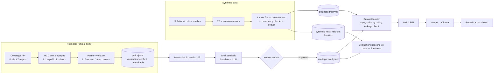

# CareImpact AI

**Healthcare policy. Translated into action.**

CareImpact AI compares two versions of a Medicare coverage policy (LCD), finds what changed with a
deterministic section-level diff, and uses a small language model to classify each change, quote the
evidence, and draft operational implications. Every quote is checked against the source text.
Generated analysis is an operational aid, **not official CMS guidance or legal/compliance advice**.

For a full explanation of the project (architecture, data, model, API, deployment), see
[PROJECT_DOCUMENTATION.md](PROJECT_DOCUMENTATION.md).



## Project layout

| Path | Purpose |
|---|---|
| `careimpact/ingestion/` | polite cached HTTP client, CMS Coverage API client, MCD page parser + validation, collection pipeline, real-example drafting & review |
| `careimpact/diffing/` | unit splitting, section canonicalisation, sentence-level diff |
| `careimpact/synthetic/` | fictional policy families (`topics.py`), scenario generator (`generator.py`), batch runner with dedup/balance (`runner.py`) |
| `careimpact/analysis/` | prompt builder (shared by training & inference), diff-only baseline, grounding/evidence validation |
| `careimpact/dataset/` | approved-only training-set builder |
| `careimpact/inference/` | Ollama client, comparison service with baseline fallback |
| `careimpact/evaluation/` | metrics, benchmark runner, markdown report |
| `careimpact/training/` | LoRA trainer (CPU/GPU), adapter merge + Ollama Modelfile export |
| `careimpact/api/` | FastAPI app, measured statistics, help-assistant chat endpoint |
| `frontend/` | single-page dashboard, help-assistant widget, 404 page (HTML/CSS/JS, no build step) |
| `configs/` | `settings.yaml`, `dataset.yaml`, `training/*.yaml` |
| `data/` | `raw/`, `interim/`, `processed/`, `training/{real,synthetic,review,final}`, `evaluation/`, `reports/`, `samples/` |
| `tests/` | pytest suite |

## Setup (Windows PowerShell)

```powershell
cd C:\Users\krish\OneDrive\Desktop\careimpact
pip install -r requirements.txt
python -m pytest -q
```
Expected: `43 passed`. If imports fail, confirm you are in the project root (the folder containing `careimpact\`).

## Step-by-step workflow

All commands run from the project root. Each writes a machine-readable report to `data\reports\`.

### 1. Synthetic data (start small, then scale)
```powershell
python -m careimpact.cli synth --split train --n 100 --seed 7        # pilot
python -m careimpact.cli synth-all --train 1000 --val 120 --test 240 --seed 7
python -m careimpact.cli samples                                      # demo pairs for the UI
```
Expected: `"accepted": 1000, "failed_checks": 0`. Inspect `data\reports\synthetic_train_report.json`
for scenario/classification balance. Examples that fail a check go to
`data\training\review\synthetic_*_failed.jsonl` and never reach training.

### 2. Real CMS data
```powershell
python -m careimpact.cli collect --limit 10            # newest LCDs; or --ids 33912,34032
python -m careimpact.cli draft-real                    # drafts from verified, non-identical pairs
python -m careimpact.cli review                        # approve / reject each draft by hand
```
`data\reports\collection_report.json` lists verified, unverified and unavailable pairs with reasons.
Drafts with unsupported quotes cannot be approved. If a retrieval fails, rerun later; the HTTP cache makes
reruns incremental (`--refresh` bypasses it).

### 3. Build the training set
```powershell
python -m careimpact.cli build-dataset
```
Writes `data\training\final\{train,val}.jsonl` (chat format) and a manifest. Fails loudly if a held-out
family or policy ID leaks into training.

### 4. Baselines and model selection (needs Ollama)
Install Ollama from https://ollama.com/download, then:
```powershell
ollama pull qwen2.5:1.5b
ollama pull qwen2.5:3b
python -m careimpact.cli evaluate --model diff-baseline
python -m careimpact.cli evaluate --model qwen2.5:1.5b --limit 60
python -m careimpact.cli evaluate --model qwen2.5:3b --limit 60
```
Results go to `data\evaluation\results\` and `data\reports\benchmark_report.md`. Each result records latency
and Ollama's reported resident model size. If Ollama is unreachable the command stops with a clear error;
the web app falls back to the diff baseline and says so.

### 5. Fine-tuning
```powershell
# feasibility test on this laptop (0.5B, 8 steps)
python -m careimpact.training.train_lora --config configs\training\cpu_smoke.yaml
```
Writes `models\runs\cpu_smoke_0p5b\{summary.json,metrics.jsonl,adapter\}`; the Dataset & Training page reads it.

For a real run use a free Colab T4 GPU (this laptop has no NVIDIA GPU; a full CPU run would take days):

1. Open https://colab.research.google.com, **File → Upload notebook**, choose `colab\finetune_colab.ipynb`.
2. **Runtime → Change runtime type → T4 GPU**, then **Runtime → Run all**. Upload `colab\careimpact_bundle.zip` when asked.
3. When it finishes (about 1–2 hours), download `careimpact/careimpact_ft.zip` from Google Drive into `Downloads`.
4. Import and benchmark it locally:
```powershell
powershell -ExecutionPolicy Bypass -File colab\import_finetuned.ps1
```
The export converts the merged model to GGUF, because current Ollama versions cannot import Qwen2 safetensors
directly ("unsupported MLX architecture"). If you change code or data, rebuild the bundle with the snippet in
`PROJECT_DOCUMENTATION.md` (section 6).

### 6. Run the app
```powershell
python -m careimpact.cli serve
```
Open http://127.0.0.1:8000. Or run it in Docker: `docker build -t careimpact .` then
`docker run -p 8000:8000 careimpact`. To use the fine-tuned model by default, set `ollama_model: careimpact-ft` in
`configs\settings.yaml` (or `$env:CAREIMPACT_OLLAMA_MODEL = "careimpact-ft"`).

## Hardware plan (i5-1235U, 16 GB RAM, Iris Xe, no NVIDIA GPU)

| Task | Local laptop | Notes |
|---|---|---|
| Inference, Qwen2.5 1.5B (Ollama Q4) | yes | ~1 GB model; CPU latency is measured by `evaluate` |
| Inference, Qwen2.5 3B (Ollama Q4) | yes | ~2 GB; slower; measure before choosing |
| Inference, Qwen2.5 7B (Q4) | possible | ~4.7 GB; likely too slow for interactive use |
| LoRA, Qwen2.5 0.5B fp32 | yes | feasibility test; see measured numbers in `models\runs\cpu_smoke_0p5b\summary.json` |
| LoRA, Qwen2.5 1.5B fp32 | marginal | ~6 GB weights + activations; feasible only for very small runs |
| QLoRA (4-bit) | **no** | bitsandbytes 4-bit training needs CUDA; Iris Xe is not supported by this stack |
| LoRA 1.5B / QLoRA 3B | Colab/Kaggle T4 | configs provided |

Qwen2.5 sizes are 0.5B, 1.5B, 3B, 7B, 14B, 32B, 72B; there is no 5B. Licensing: 0.5B/1.5B/7B are Apache-2.0;
**3B uses the Qwen Research License (non-commercial)**.

## Data integrity rules enforced in code
* A version is `verified` only if the page's embedded document ID and version, the LCD ID field and the title match
  the request and real policy content was extracted. HTTP 200 alone is not success.
* Pairs whose old version cannot be retrieved are recorded as `unavailable`; nothing is fabricated.
* Synthetic policies use `SYN-` IDs, "(Synthetic)" titles and a fictional contractor; labels come from the scenario
  spec, not from an LLM.
* Real drafts stay `pending_review` until a person approves them, and only approved real examples enter training.
* Evidence quotes are exact-match checked (whitespace-normalised) against the source text, in training data and at
  inference.
* Synthetic and real evaluation results are reported separately.
* The CMS API license (AMA CPT terms) is never accepted automatically (`accept_cms_api_license: false`).
